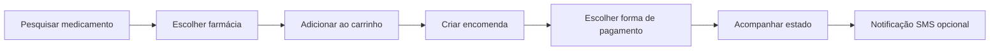
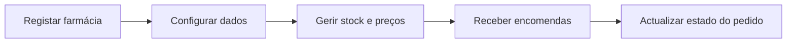
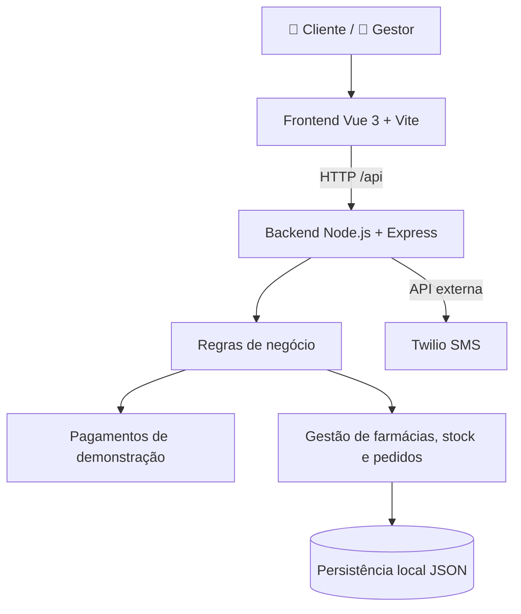

<div align="center">

# 💊 FarmaRede

### Farmácias mais próximas. Medicamentos mais acessíveis. Uma experiência conectada.

**Uma plataforma web para pesquisar medicamentos, encontrar farmácias, consultar disponibilidade e acompanhar encomendas.**

[](https://vuejs.org/)
[](https://vite.dev/)
[](https://nodejs.org/)
[](https://expressjs.com/)
[](https://www.twilio.com/)

**Projecto académico · Programação Web II · ISUTC**

[Aplicação](#-acesso-à-aplicação) · [Funcionalidades](#-o-que-construímos) · [Dados](#-fontes-de-dados) · [Arquitectura](#-arquitectura-do-sistema) · [Instalação](#-como-executamos-localmente) · [Equipa](#-equipa-do-grupo-7)

</div>

---

## 🌐 Acesso à aplicação

| Recurso | Endereço |
|:--|:--|
| **Código-fonte público** | [GitHub — FarmaRede](https://github.com/AnikTaju-code/FarmaRede) |
| **Aplicação no GitHub Pages** | **Pendente de confirmação:** inserir aqui o endereço público da aplicação após verificar a publicação |

> [!WARNING]
> O endereço do GitHub Pages ainda não foi confirmado. Antes da entrega, substituímos esta indicação pelo URL real e verificamos que a aplicação abre num navegador sem autenticação.

## 🌍 A nossa proposta

Desenvolvemos o **FarmaRede** para aproximar clientes e farmácias numa única plataforma digital. Queremos facilitar a procura de medicamentos e a consulta de disponibilidade, ao mesmo tempo que disponibilizamos às farmácias ferramentas para gerir o seu catálogo, stock e encomendas.

A nossa solução organiza a experiência em dois perfis principais: **cliente** e **gestor de farmácia**. No percurso de compra, integramos validação de números para M-Pesa e e-Mola, pagamentos em **modo de demonstração** e notificações SMS através da API Twilio, quando configurada.

> [!IMPORTANT]
> **Transparência funcional:** os pagamentos M-Pesa/e-Mola aqui descritos são validados e demonstrados; **não constituem cobranças reais**. Na conta experimental do Twilio, o envio de SMS está sujeito às restrições do fornecedor, incluindo modelos de mensagem predefinidos.

## ✨ O que construímos

| Área | O que disponibilizamos |
|:--|:--|
| 🔎 **Pesquisa** | Navegação por medicamentos, filtros e visualização de detalhes |
| 📍 **Localização** | Consulta de farmácias no mapa e utilização de coordenadas para proximidade |
| 🏪 **Farmácias** | Registo e gestão de dados da farmácia e respectivo stock |
| 🛒 **Carrinho** | Selecção de produtos e preparação de encomendas |
| 📦 **Pedidos** | Registo, histórico e acompanhamento dos estados das encomendas |
| 💳 **Pagamentos** | Validação dos números M-Pesa (84/85) e e-Mola (86/87), além de pagamento presencial e demonstração |
| 📲 **SMS** | Integração com Twilio para notificações, mediante credenciais e permissões do fornecedor |
| 🔄 **Actualizações** | Comunicação de eventos de alterações de stock, pedidos e farmácias a partir do backend |
| 🔐 **Acesso** | Autenticação e diferenciação de operações por perfil |

### 👤 Percurso do cliente



### 🏪 Percurso do gestor



## 🗺️ Fontes de dados

Utilizamos **OpenStreetMap (OSM)** como fonte de informação geográfica para a localização de farmácias na área de Maputo, Moçambique. A consulta é organizada no módulo `frontend/src/composables/useFarmaciasOSM.js`, separado dos componentes de apresentação.

| Fonte | Dados e utilização | Referência |
|:--|:--|:--|
| **OpenStreetMap** | Localizações e informação geográfica pública de farmácias na região de Maputo | [openstreetmap.org](https://www.openstreetmap.org/) |
| **Catálogo da aplicação** | Produtos, preços e disponibilidade registados no sistema para demonstração | Dados internos do projecto; **não** constituem um dataset público de stock farmacêutico |

**Origem e licença:** © OpenStreetMap contributors. Os dados OSM são disponibilizados sob a [Open Database License (ODbL)](https://www.openstreetmap.org/copyright). Respeitamos a atribuição exigida pela fonte e distinguimos os pontos geográficos públicos das farmácias e dos produtos registados na nossa aplicação.

**Tratamento dos dados:** procuramos apresentar estados de carregamento, erro e ausência de resultados. A existência de um ponto no mapa não garante que o estabelecimento esteja registado na plataforma nem que possua determinado medicamento em stock.

## 🧩 Arquitectura do sistema

Organizámos a aplicação numa arquitectura cliente-servidor. O frontend Vue comunica com uma API HTTP Express, que aplica as regras de negócio e persiste os dados. A integração Twilio é executada **exclusivamente no backend** para manter as credenciais fora do navegador.



### 🛠️ Tecnologias

| Camada | Tecnologias e utilização |
|:--|:--|
| Interface | Vue 3, componentes `.vue`, Vite, CSS |
| Comunicação HTTP | Axios no frontend; Express no backend |
| Backend | Node.js, JavaScript (módulos ES) |
| Segurança HTTP | Helmet, CORS e limitação de pedidos nas rotas de autenticação |
| Persistência | Ficheiro JSON gerido por `store.js` |
| Localização | Coordenadas e cálculo de distância; módulo de farmácias/OSM |
| SMS | API REST Twilio |
| Testes | Test runner nativo do Node.js |
| Controlo de versões | Git e GitHub |

## 🗂️ Organização do projecto

```text
FarmaRede/
├── backend/
│   ├── src/
│   │   ├── server.js            # API e rotas
│   │   ├── logic.js             # Regras de negócio
│   │   ├── catalog.js           # Catálogo e distância
│   │   ├── store.js             # Persistência JSON
│   │   ├── pagamentos.js        # Validação dos pagamentos
│   │   ├── pagamentos.test.js   # Testes automatizados
│   │   └── sms.js               # Integração Twilio
│   ├── .env.example             # Exemplo de configuração
│   └── package.json
├── frontend/
│   ├── src/
│   │   ├── assets/              # Estilos
│   │   ├── components/          # Componentes reutilizáveis
│   │   ├── composables/         # Lógica reutilizável
│   │   ├── services/api.js      # Cliente HTTP
│   │   ├── stores/              # Estado da aplicação
│   │   ├── views/               # Páginas
│   │   ├── App.vue
│   │   ├── main.js
│   │   └── router.js
│   ├── index.html
│   ├── vite.config.js
│   └── package.json
└── README.md
```

## 🚀 Como executamos localmente

### Pré-requisitos

Precisamos de **Node.js**, **npm** e **Git**. Os comandos abaixo são apresentados para **PowerShell no Windows**, a partir da pasta principal do repositório.

**1. Obter o projecto**

```powershell
git clone https://github.com/AnikTaju-code/FarmaRede.git
cd FarmaRede
```

> Para trabalhar especificamente na branch de integração do Sousa, executamos `git switch Sousa` após `git fetch origin`. Não alteramos a branch principal sem coordenação da equipa.

**2. Configurar o backend**

```powershell
cd backend
Copy-Item .env.example .env
npm.cmd install
```

Editamos `backend/.env` com as variáveis necessárias. Por exemplo:

```dotenv
PORT=
PAYMENT_MODE=
DATA_DIR=
FRONTEND_ORIGIN=
JWT_SECRET=
TWILIO_ACCOUNT_SID=
TWILIO_AUTH_TOKEN=
TWILIO_FROM=
TWILIO_MESSAGING_SERVICE_SID=
```

| Variável | Finalidade |
|:--|:--|
| `PORT` | Porta de execução do backend |
| `PAYMENT_MODE` | Modo de funcionamento dos pagamentos, incluindo demonstração |
| `DATA_DIR` | Directório de persistência local |
| `FRONTEND_ORIGIN` | Origens autorizadas a comunicar com a API |
| `JWT_SECRET` | Segredo utilizado na autenticação |
| `TWILIO_ACCOUNT_SID` | Identificador da conta Twilio |
| `TWILIO_AUTH_TOKEN` | Credencial privada do serviço Twilio |
| `TWILIO_FROM` | Remetente de SMS autorizado |
| `TWILIO_MESSAGING_SERVICE_SID` | Identificador opcional do Messaging Service Twilio |

**Os campos acima são intencionalmente apresentados sem valores.** Preenchemos apenas no ficheiro local `backend/.env`, conforme o ambiente utilizado. Não publicamos esse ficheiro nem credenciais reais.


**Nunca publicamos credenciais reais.** Se não pretendermos testar SMS, deixamos os campos Twilio vazios. Para utilização de um Messaging Service, podemos configurar `TWILIO_MESSAGING_SERVICE_SID` em alternativa ao remetente, de acordo com a implementação.

**3. Iniciar o backend (terminal 1)**

```powershell
cd backend
node --env-file=.env src/server.js
```

Se já estivermos dentro da pasta `backend`, executamos apenas o comando `node`. Não fechamos este terminal enquanto utilizamos a API.

**4. Iniciar o frontend (terminal 2)**

```powershell
cd frontend
npm.cmd install
npm.cmd run dev
```

Abrimos o endereço indicado pelo Vite, habitualmente **http://localhost:5173**.

> [!TIP]
> No PowerShell, usamos `npm.cmd` caso a política de execução do Windows bloqueie `npm.ps1`. Assim, não precisamos de alterar a política de segurança do sistema.

**5. Confirmar a comunicação**

```powershell
Invoke-RestMethod http://localhost:3001/api/saude
Invoke-RestMethod http://localhost:3001/api/farmacias
```

A rota `/api/saude` permite verificar se a API está activa e consultar o modo de pagamento e a configuração do SMS. A lista de farmácias pode estar vazia num ambiente recém-criado; isso não significa que o servidor esteja avariado.

### Se o frontend não comunicar com a API

Podemos criar `frontend/.env.local` com:

```dotenv
VITE_API_URL=
```

Definimos localmente o endereço da API de acordo com o ambiente em que executamos o backend.

Também verificamos se `FRONTEND_ORIGIN` inclui a origem exacta usada no navegador (`localhost` ou `127.0.0.1`). Reiniciamos os processos após alterações aos ficheiros `.env`.

## 🔌 API e integrações

A nossa API utiliza o prefixo `/api`. Entre as rotas identificadas no backend estão:

| Método | Rota | Finalidade |
|:--|:--|:--|
| `GET` | `/api/saude` | Consultar o estado do serviço |
| `GET` | `/api/farmacias` | Listar farmácias e, com coordenadas, calcular proximidade |
| `POST` | `/api/pedidos/:id/simular-pagamento` | Aprovar ou recusar pagamento de demonstração, com autenticação |
| `PATCH` | `/api/pedidos/:id/estado` | Actualizar o estado de uma encomenda, com permissões de gestor |
| `PATCH` | `/api/stock/:farmaciaId/:medicamentoId` | Actualizar quantidade e preço com verificação de versão |

As rotas protegidas exigem autenticação e as permissões correspondentes. A documentação acima apresenta exemplos representativos e não substitui a consulta do código-fonte para a lista integral de endpoints.

### 💳 Pagamentos: validação e demonstração

Distinguimos a **validação do número** da **execução de uma transacção financeira**.

| Método | Prefixos aceites | Comportamento |
|:--|:--|:--|
| M-Pesa | `84`, `85` | Validamos o formato e permitimos demonstração do pagamento |
| e-Mola | `86`, `87` | Validamos o formato e permitimos demonstração do pagamento |
| Presencial | — | Registamos a opção de pagamento presencial |

Com `PAYMENT_MODE=demo`, a aprovação ou recusa é simulada dentro da aplicação. **Não movimentamos dinheiro real nem confirmamos pagamentos junto de operadoras financeiras.**

### 📲 SMS: Twilio

Ligámos o backend à API Twilio para preparar notificações de encomendas. Mantemos o SID, o token e a identificação do remetente em variáveis de ambiente privadas.

**Importante:** uma resposta `queued` ou `enviado_ao_provedor` significa que o fornecedor aceitou o pedido de envio; não garante, por si só, a entrega ao destinatário. Em contas de avaliação, o Twilio pode aceitar apenas modelos de SMS predefinidos. Para mensagens personalizadas em produção, é necessário cumprir os requisitos da conta e do remetente.

## 🛡️ Segurança e integridade

Adoptámos medidas básicas de protecção e consistência:

- **Segredos no servidor:** credenciais em `.env`, nunca no código público do frontend.
- **CORS:** restringimos as origens autorizadas da aplicação.
- **Protecção HTTP:** utilizamos Helmet e limites de pedidos nas rotas de autenticação.
- **Permissões:** distinguimos operações de cliente e de gestor de farmácia.
- **Stock:** validamos quantidades, preços e versões antes de actualizar registos.
- **Histórico:** registamos alterações de estado de encomendas.
- **Persistência:** guardamos o estado local em JSON, com escrita através de ficheiro temporário.

> [!WARNING]
> A persistência em JSON é adequada ao contexto actual do projecto e à demonstração local, mas não deve ser apresentada como uma solução de base de dados transaccional preparada para grande escala. Para produção, precisamos de reforçar concorrência, auditoria, backups e persistência.

## 🧪 Testes e validação

Executamos os testes automatizados dos pagamentos com:

```powershell
cd backend
node --test src/pagamentos.test.js
```

Os testes existentes verificam a aceitação e rejeição dos prefixos M-Pesa/e-Mola, a recusa de números inválidos, a opção de pagamento presencial e o comportamento de demonstração.

Para verificar a compilação da interface:

```powershell
cd frontend
npm.cmd run build
```

Também realizamos testes manuais de navegação, ligação à API, consulta de farmácias e integração SMS. **O sucesso de uma compilação não equivale à validação de todos os fluxos de negócio**, pelo que continuamos a testar cada percurso de ponta a ponta.

## 🧭 Próximas melhorias

Como evolução do projecto, pretendemos aprofundar os testes de integração e de interface, melhorar a documentação de todas as rotas, reforçar a persistência para cenários concorrentes e preparar uma publicação estável do frontend e do backend. Qualquer integração com pagamentos reais exigirá uma implementação própria, credenciais oficiais e validação segura junto dos respectivos fornecedores.

## 👥 Equipa do Grupo 7

| Membro | Nº de estudante | Utilizador GitHub |
|:--|:--:|:--|
| Armando Macamo | 8106 | [@armando-liedson-dev](https://github.com/armando-liedson-dev) |
| Anik Taju | 8650 | [@AnikTaju-code](https://github.com/AnikTaju-code) |
| Narciso Boa | 6359 | [@Narcissus-Celxoa](https://github.com/Narcissus-Celxoa) |
| Sousa Marufo | 8428 | [@marufosousa](https://github.com/marufosousa) |

## 🤝 Trabalho em equipa

Desenvolvemos o FarmaRede de forma colaborativa, com branches individuais e integração progressiva de funcionalidades. Utilizamos o GitHub para preservar o histórico de alterações, facilitar revisões e organizar a contribuição dos membros.

**Repositório:** [AnikTaju-code/FarmaRede](https://github.com/AnikTaju-code/FarmaRede)

**Branches de trabalho:** `Anik`, `Armando`, `Narciso` e `Sousa`, além da branch `main`.

Antes de integrar alterações, verificamos a branch activa, executamos os testes relevantes e revemos os ficheiros modificados. Evitamos incluir `.env`, `node_modules`, `dist` e backups locais nos commits.

## 🤖 Ferramentas de apoio e integridade académica

Durante a preparação da documentação do FarmaRede, recorremos ao **ChatGPT (OpenAI)** como ferramenta de apoio à estruturação, revisão linguística e verificação da cobertura dos requisitos do README e do BRD. A equipa é responsável por rever, compreender e validar os conteúdos entregues.

Antes da submissão, registaremos aqui quaisquer **outras ferramentas de IA efectivamente utilizadas** no código, nos testes, no desenho ou na pesquisa, identificando a ferramenta, a finalidade e a parte do projecto em que foi utilizada. Não atribuímos a ferramentas de IA actividades cuja utilização não tenha sido confirmada pela equipa.

As bibliotecas e os serviços externos utilizados encontram-se identificados nas secções **Tecnologias**, **Fontes de dados** e **API e integrações**. Respeitamos as respectivas condições de utilização e atribuição.

## 🎓 Contexto académico

Este projecto foi desenvolvido no âmbito da unidade curricular de **Programação Web II**, no **Instituto Superior de Transportes e Comunicações (ISUTC)**. Procuramos aplicar, num cenário prático, conceitos de desenvolvimento web, APIs, componentes reutilizáveis, autenticação, regras de negócio, integração com serviços externos e colaboração com Git.

---

<div align="center">

### 💚 FarmaRede

**Construímos tecnologia para aproximar pessoas, farmácias e cuidados de saúde.**

*Projecto académico · Desenvolvido em equipa*

</div>
